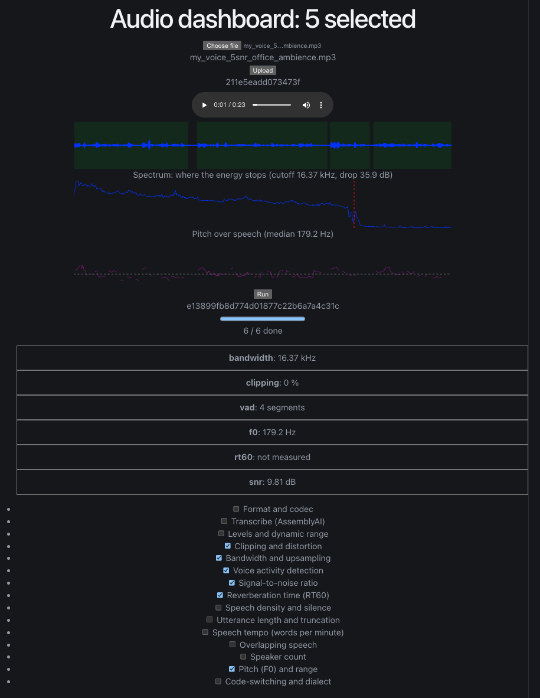
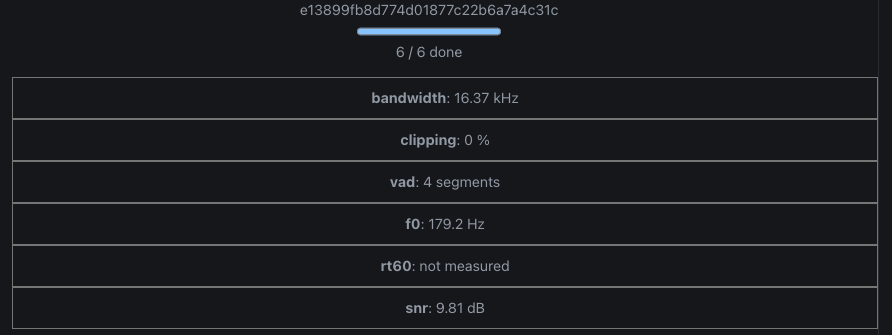

# Audio analysis dashboard

A tool for looking at an audio file and the transcript it produced, side by
side with the acoustic measurements that might explain the errors in it.



## Running it

You need two terminals. The first one runs the API from the repo root.

```bash
uv sync
uv run uvicorn audio_dashboard.api.main:app --reload
```

The second one runs the front end from the `frontend` folder.

```bash
cd frontend
npm install
npm run dev
```

Then open http://localhost:5173 to use the dashboard. You can also open
http://127.0.0.1:8000/docs to try every API endpoint from the browser.

Transcription needs API keys in a `.env`:

```
ASSEMBLYAI_API_KEY=...
ELEVENLABS_API_KEY=...
```

Everything except transcription works without them.

## How it works

| Endpoint | What it does |
|---|---|
| `GET /v1/analyses` | Lists every analysis, its group, what it requires and what it costs. |
| `POST /v1/files` | Uploads audio. Returns the file's content hash (`digest`): 201 when new, 200 when the same bytes were uploaded before. |
| `POST /v1/files/{digest}/runs` | Starts the chosen analyses in the background. Returns 202 with a `run_id` and a `Location` pointing at the run. |
| `GET /v1/runs/{run_id}` | The status of one run (`queued`, `running`, `done` or `failed`), how far it has got, and its results once it is done. |
| `GET /v1/files/{digest}/runs` | Every run made for one file, newest first. |
| `GET /v1/files/{digest}/waveform` | The loudest and quietest value in each slice of the file, for drawing the waveform. The `points` query value sets how many slices (the default is 4000). |
| `GET /v1/files/{digest}/audio` | The uploaded file itself, so a browser can play it. |

A run does not block the request. The client starts it, then asks for the run
every second until the status is `done` or `failed`. A run that was still going
when the server restarted is marked `failed`, so a client never waits for it
forever. Runs are stored in a SQLite file at `data/runs.db`.

Choosing an analysis pulls in whatever it depends on, and the run response
lists everything that actually ran. A run that would transcribe a file with no
cached transcript is refused with 403 unless the request sets
`allow_billing`, so nothing is billed by surprise.

Results are cached on disk under `.cache/features/`, keyed by the file's
content hash rather than its name, so re-running on the same audio is instant.
Transcripts have their own cache under `.cache/transcripts/`, which means each
file is only ever billed once.

"We measured no reverberation problem" and "we did not measure reverberation"
must never look the same. An analysis that could not produce a usable number
says so, and that distinction is kept all the way through.

## The front end

The front end is a React page in `frontend/`, built with Vite. You choose a
file, upload it, tick the analyses you want and press Run. A progress bar shows
how many analyses have finished. When the run is done, each analysis shows its
main number as a card, and "not measured" when it could not produce one.



Under the audio player there are three charts, all drawn as plain SVG.

- **Waveform.** The loudness of the file over time. Green bands mark where voice
  activity detection found speech, and red lines mark where the waveform is
  clipped. The green bands need the `vad` analysis and the red lines need the
  `clipping` analysis.
- **Spectrum.** How much energy the file has at each frequency, with a dashed
  line at the detected cutoff. It needs the `bandwidth` analysis.
- **Pitch.** The pitch of the voice over time, with a dashed line at the median.
  It needs the `f0` analysis.

## Reading the numbers

The judgements live in `src/audio_dashboard/interpret.py`, separately from the
extractors that produce the numbers. One catalogue entry per metric holds the
plain-English name, what is being measured, why an ASR model cares, and the
bands that decide whether a value is fine or a problem. Anything that shows a
metric reads that same catalogue, so a number and its explanation cannot drift
apart.

Every metric says where its bands came from. Some are thresholds from
`notes.md`, kept in `thresholds.py` and imported rather than restated. The rest
are conventional ranges with nothing citable behind them, and they say so — a
tuned threshold and a guess should not look alike on screen.

Nothing there ever colours an unmeasured value green. A metric that was not
run, or whose analysis failed or declined, reads as "not measured".

### Choosing the low-confidence cutoff

`stats.resolve_threshold` offers three ways to set it: a fixed confidence value, a target highlight rate,
or a target rate with a floor. The fixed value defaults to 0.9. Published
optimal thresholds range 0.41-0.94 across transcripts (arXiv:2503.15124), and
the median word here comes back around 0.998, so a lower cutoff marks almost
nothing and makes a bad file look clean.

## What is measured

Section 1 and the format metadata come from `ffprobe` and are exact. Everything
else is computed from the decoded signal and carries some uncertainty:

- **SNR** is a real measurement when voice activity detection is also selected
  — speech-frame level against non-speech-frame level. Without it, it falls
  back to a percentile split of frame energy, which is a guess. The result's
  `method` field says which one produced the number. Frames of digital silence
  (exact zeros from padding or editing) do not count as noise: with no real
  noise floor to compare against, the result says so instead of reporting an
  enormous SNR.
- **RT60** is a blind estimate. There is no impulse response, so it fits a
  decay to the tail after each speech offset and extrapolates from 20 dB to
  60 dB. With few usable windows it means very little, so the window count is
  shown next to it.
- **Bandwidth** looks for a cliff in the spectrum, not for a fixed distance
  below the spectral peak. Speech spectra slope downwards on their own, and
  thresholding against the peak flags every speech recording ever made as
  narrowband.
- **Overlap** does not work on mono audio, and now says so rather than
  reporting zero. Measured against files built with a known amount of overlap
  in them, it found none of it: mono diarisation assigns every moment to
  exactly one speaker, so there is never an overlapping utterance to find.
- **Code-switching and dialect detection** are not implemented. Doing it
  honestly needs a windowed language-ID model. It is registered so the gap is
  visible rather than silently absent.

## Vendored modules

`asr.py`, `stats.py`, `render.py` and `salience.py` were written for an earlier
transcript experiment and are copied in rather than imported, so this repo
stands alone. `asr.py` keeps its original cache-key scheme, so transcripts
cached by that experiment can be dropped into `.cache/transcripts/` here and
are picked up as hits.

## Tests

```bash
uv run pytest
cd frontend && npm run lint && npm run build
```

The same checks run on every push and pull request through GitHub Actions. The
backend job runs `ruff` and `pytest`, and the front end job runs the linter and
the build.

No test calls an API — the transcript tests run only against a file already in
the cache, and skip otherwise. The quality extractors are checked against signals whose
properties were constructed — a sine at a known amplitude, a deliberately
clipped one, a genuinely resampled narrowband file, speech-plus-noise at a set
ratio. The API is tested end to end with FastAPI's `TestClient`, against a
temporary upload folder, with the paid transcription call replaced so a broken
billing check fails the test instead of spending money. One test uses a local
corpus of constructed files if it happens to be present, and skips otherwise.

## Licence

This project is released under the MIT licence. The full text is in `LICENSE`.
